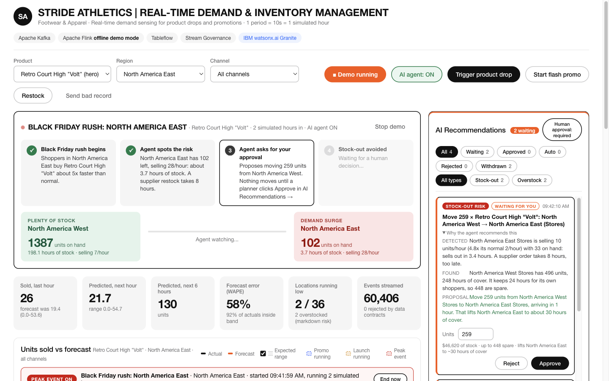
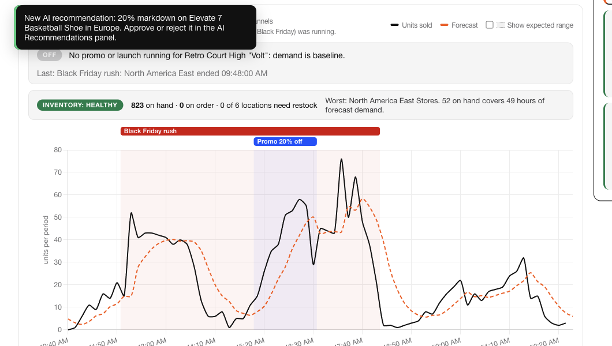
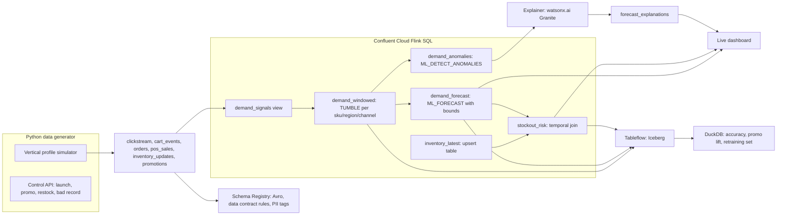

# Real-Time Demand Forecasting for Launches and Promotions

A reusable Confluent Cloud demo: retail events stream into Kafka, Flink SQL forecasts
demand per SKU, region and channel with the built-in `ML_FORECAST` function, compares
forecasts against inventory to flag stockout and overstock risk, and IBM watsonx.ai
(Granite) explains forecast shifts in plain language. Tableflow lands the history in
Iceberg for analytics and retraining.

The demo is customer-neutral. It ships with two vertical profiles, a sneaker/apparel
brand with product drops (`apparel_drops`) and a grocery chain with weekly promos
and demand surges (`grocery`). You can re-skin it for any customer in about a minute.



A product drop breaks out of the forecast band, and the forecast adapts within a period:



These screenshots come from rehearsal mode (`make dashboard-offline`), so the header shows
"offline demo mode" instead of `ML_FORECAST`.

## Architecture



One period is 10 seconds of wall-clock time and represents one simulated hour, so a
simulated day takes 4 minutes. At startup the generator backfills 72 periods (3 simulated
days) so forecasts are warm almost immediately.

## Repository layout

| Path | What it does |
| --- | --- |
| [terraform/](terraform/) | Environment (Stream Governance Advanced), Standard Kafka cluster on AWS us-east-1, Flink compute pool, service accounts, API keys, topics, Avro schemas with data contract rules and tags, Flink statements, Tableflow. Writes `.env`. |
| [schemas/](schemas/) | Avro schemas. PII fields are tagged inline with `confluent:tags`. |
| [flink/](flink/) | The Flink SQL pipeline, numbered in execution order. Terraform deploys the same files. `99_presenter_queries.sql` has ad-hoc queries for the live demo. |
| [datagen/](datagen/) | Simulator, Avro producer that enforces data contracts, control API on port 8001, vertical profiles. |
| [explainer/](explainer/) | Consumes anomalies, calls watsonx.ai Granite, writes `forecast_explanations`. |
| [dashboard/](dashboard/) | FastAPI with Server-Sent Events, plus a Chart.js single page on port 8000. |
| [analytics/](analytics/) | Reads Tableflow Iceberg tables via the REST catalog, then runs DuckDB SQL. |
| [docs/DEMO_SCRIPT.md](docs/DEMO_SCRIPT.md) | 15-20 minute talk track, discovery questions, re-skin checklist. |

## Prerequisites

- A Confluent Cloud org and a **Cloud resource management API key** owned by a user or
  service account with OrganizationAdmin.
- Terraform 1.5+ (`brew install terraform`).
- [uv](https://docs.astral.sh/uv/) for Python 3.12. Python 3.14 does not work yet, because
  the data contract rule engine depends on `google-re2`, which has no 3.14 wheel.
- Optional: IBM watsonx.ai API key, project ID and region URL. Without them, the explainer
  falls back to a deterministic template so the demo still runs.
- Optional: enrollment in the `AI_FORECAST` Early Access Program (IBM Granite TTM hosted
  by Confluent) if you want to show the foundation-model forecast alongside ARIMA.

## Setup (about 15 minutes, mostly Terraform)

```bash
make venv

cp terraform/terraform.tfvars.example terraform/terraform.tfvars   # add your Cloud API key
make up                    # creates everything and writes .env and .env.local

# Optional: add WATSONX_* and branding to .env.local

# Three terminals:
make gen                   # or: make gen PROFILE=grocery
make explainer
make dashboard             # http://localhost:8000
```

Within about a minute of starting the generator, the dashboard shows actuals, forecasts
and risk. Then follow [docs/DEMO_SCRIPT.md](docs/DEMO_SCRIPT.md).

After about 15 minutes, once Tableflow has committed snapshots, run:

```bash
make analytics
```

Tear everything down with `make down`.

### Rehearsal mode (no cloud)

`make dashboard-offline` runs the same dashboard against the local simulator, using
exponential smoothing in place of Flink. `make analytics-offline` runs the analytics SQL
on synthetic data. Use these to practice the talk track or to show the UI when there is
no network. They are not a substitute for the real pipeline.

## Re-skin for a customer

1. Set `BRAND_NAME` and `BRAND_COLOR` in `.env.local`. The dashboard header, logo
   initials and accent color update on restart.
2. For a closer fit, copy a profile, for example `datagen/profiles/grocery.yaml` to
   `datagen/profiles/acme.yaml`. Edit products, regions, channel names, daily curve,
   launch and promo labels. Run with `PROFILE=acme`.
3. Optionally set `prefix = "acme-demand"` in `terraform.tfvars` so the environment and
   cluster names match the customer.

Keep `period.seconds` at 10 unless you also change the `TUMBLE` interval in
[flink/02_demand_windowed.sql](flink/02_demand_windowed.sql).

## Cost notes

This demo runs a Standard cluster, a Flink compute pool (the ML functions bill as
CFUs in that pool), Stream Governance Advanced, and Tableflow with Confluent-managed
storage. Stop the generator when you are not presenting, and run `make down` after the
meeting.

## Troubleshooting

- **Forecast columns are null.** `ML_FORECAST` needs `minTrainingSize` (16) periods per
  series before it emits values. The backfill covers this. If you started with
  `--backfill 0`, wait about 3 minutes.
- **Windows never close.** Event-time windows advance only while every partition receives
  data. Keep the generator running, because it writes to all partitions every period.
- **`fc[1]` errors in `03_demand_forecast.sql`.** The SQL expects `ML_FORECAST` to return
  an array with one row per horizon step, which is the current Confluent Cloud behavior.
  Run `DESCRIBE demand_forecast` or `SELECT ML_FORECAST(...)` in the workspace to check
  the shape in your environment.
- **Bad record is accepted.** Data contract rules require Stream Governance Advanced,
  and the producer must run with the `rules` extra installed (`make venv` installs it).
- **AI_FORECAST fails.** It is Early Access. Leave `enable_ai_forecast = false` unless
  your org is enrolled.
- **No explanations.** The explainer only explains anomalies from the last 3 minutes and
  waits 60 seconds per SKU between explanations. Trigger a launch and wait 2 periods.
  Run `python -m explainer.main --list-models` to check the Granite model IDs available
  in your watsonx region.
- **Analytics cannot find tables.** Tableflow namespaces are the Kafka cluster ID, and the
  first snapshot can take several minutes after the topic is enabled.
